# Diagram Alur

Diagram ini dihasilkan dari isi alur di `src/main.cpp` (30 kartu). Kotak biru adalah pertanyaan, kotak hijau bulat adalah hasil akhir. Di program, angka `0` selalu berarti kembali ke menu utama (atau keluar jika sudah di menu utama), dan tidak digambar supaya diagram tetap terbaca.

Tiga jalur dari menu utama:

- **Saya baru datang atau bingung harus ke mana**: berdasar wawancara. Nama bagian dan cabang masih dummy.
- **Cara masuk lewat entry gate**: berdasar wawancara staf. Alasan resmi pencatatan NIM belum diverifikasi.
- **Layanan lain**: dugaan penulis, belum divalidasi wawancara.

```mermaid
flowchart TD
    mulai["Kamu butuh bantuan apa?"]
    datang["Apa keperluanmu hari ini?"]
    d_pinjam(["Tuju bagian layanan sirkulasi di cabang yang kamu tuju…"])
    d_belajar(["Tuju area baca di cabang yang kamu tuju. 2. Pastikan k…"])
    d_admin(["Tuju meja keanggotaan atau administrasi. 2. Bawa ident…"])
    d_bingung(["Tidak apa-apa, memilih cabang atau bagian memang bisa…"])
    gate["Apakah kamu sudah memasukkan NIM di entry gate saat masuk?"]
    g_sudah(["Bagus. Lakukan hal yang sama setiap kali masuk (contoh…"])
    g_belum(["Masukkan NIM di entry gate setiap kali masuk (contoh).…"])
    lain["Pilih topik (contoh alur, belum divalidasi wawancara):"]
    bp_pinjaman["Apakah kamu masih punya buku yang belum dikembalikan?"]
    bp_kembalikan(["Kembalikan dulu semua buku yang masih dipinjam ke meja…"])
    bp_repo["Apakah tugas akhirmu sudah diunggah ke repositori?"]
    bp_unggah(["Unggah tugas akhirmu ke repositori lebih dulu. Lihat m…"])
    bp_siap(["Syarat dasar tampaknya sudah terpenuhi (contoh). 1. Si…"])
    kartu["Apa kondisi kartu anggotamu?"]
    kartu_baru(["Datang ke meja keanggotaan dengan identitas mahasiswa.…"])
    kartu_hilang(["Laporkan kehilangan ke meja keanggotaan secepatnya. 2.…"])
    kartu_masalah(["Kemungkinan penyebab (contoh): kartu belum diaktifkan,…"])
    pinjam["Apa yang ingin kamu ketahui?"]
    perpanjang["Apakah buku sudah melewati tanggal jatuh tempo?"]
    perpanjang_ok(["Kemungkinan masih bisa diperpanjang (contoh). 1. Cek a…"])
    perpanjang_lewat(["Buku sudah terlambat (contoh). 1. Kembalikan buku ke m…"])
    denda(["Aturan denda berbeda di tiap perpustakaan. Prototipe i…"])
    elib["Dari mana kamu mengakses e-library?"]
    elib_kampus(["Buka halaman e-library perpustakaan. 2. Masuk dengan a…"])
    elib_luar(["Beberapa sumber hanya bisa dibuka dari jaringan kampus…"])
    repo["Apa kendalamu dengan repositori?"]
    repo_cara(["Siapkan berkas final tugas akhir (biasanya PDF). 2. Si…"])
    repo_revisi(["Baca catatan dari staf dengan teliti. 2. Periksa kelen…"])
    mulai -->|"Saya baru datang atau bingung harus ke mana"| datang
    mulai -->|"Cara masuk lewat entry gate"| gate
    mulai -->|"Layanan lain (contoh, belum divalidasi wawan…"| lain
    datang -->|"Meminjam atau mengembalikan buku"| d_pinjam
    datang -->|"Belajar atau membaca di tempat"| d_belajar
    datang -->|"Mengurus keanggotaan atau administrasi"| d_admin
    datang -->|"Belum tahu cabang atau bagian yang dituju"| d_bingung
    gate -->|"Sudah"| g_sudah
    gate -->|"Belum, atau aku lupa"| g_belum
    lain -->|"Bebas pustaka"| bp_pinjaman
    lain -->|"Kartu anggota"| kartu
    lain -->|"Pinjaman, perpanjangan, dan denda"| pinjam
    lain -->|"Akses e-library"| elib
    lain -->|"Unggah tugas akhir ke repositori"| repo
    bp_pinjaman -->|"Ya, masih ada"| bp_kembalikan
    bp_pinjaman -->|"Tidak ada"| bp_repo
    bp_repo -->|"Sudah"| bp_siap
    bp_repo -->|"Belum"| bp_unggah
    kartu -->|"Belum punya"| kartu_baru
    kartu -->|"Hilang atau rusak"| kartu_hilang
    kartu -->|"Ada, tapi tidak bisa dipakai"| kartu_masalah
    pinjam -->|"Memperpanjang pinjaman"| perpanjang
    pinjam -->|"Denda keterlambatan"| denda
    perpanjang -->|"Belum"| perpanjang_ok
    perpanjang -->|"Sudah lewat"| perpanjang_lewat
    elib -->|"Dari dalam kampus"| elib_kampus
    elib -->|"Dari luar kampus"| elib_luar
    repo -->|"Belum tahu cara mengunggah"| repo_cara
    repo -->|"Unggahanku diminta direvisi"| repo_revisi
    classDef hasil fill:#e8f5e9,stroke:#2e7d32,color:#000;
    classDef tanya fill:#e3f2fd,stroke:#1565c0,color:#000;
    class d_pinjam,d_belajar,d_admin,d_bingung,g_sudah,g_belum,bp_kembalikan,bp_unggah,bp_siap,kartu_baru,kartu_hilang,kartu_masalah,perpanjang_ok,perpanjang_lewat,denda,elib_kampus,elib_luar,repo_cara,repo_revisi hasil;
    class mulai,datang,gate,lain,bp_pinjaman,bp_repo,kartu,pinjam,perpanjang,elib,repo tanya;
```

